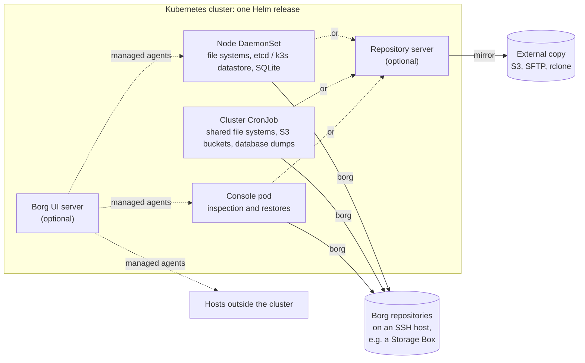

# k8s-borg

[](https://github.com/ioanalytica/k8s-borg/actions/workflows/lint-test.yml)
[](https://github.com/ioanalytica/k8s-borg/actions/workflows/cve-scan.yml)
[](https://github.com/ioanalytica/k8s-borg/releases/latest)
[](LICENSE)

Backup for Kubernetes clusters with [BorgBackup](https://www.borgbackup.org/),
packaged as one container image and one Helm chart. k8s-borg runs in production
on Borg 1.

It backs up the nodes, the cluster's shared data, S3 buckets and databases, each
into its own Borg repository. A repository server for Borg 1 and Borg 2 can run
in the same release and keep an external copy of its repositories. Optionally, a
[Borg UI](https://github.com/karanhudia/borg-ui) server deployed by the chart
drives the backups as managed agents, and the same server takes agents on hosts
outside the cluster, so one place shows the backups of clusters and machines
alike.

## Why k8s-borg

- **One release backs up the whole cluster**: the nodes' file systems, the
  cluster datastore (etcd or k3s), dumps of MariaDB, MySQL, PostgreSQL, MongoDB,
  Redis and Valkey, S3 buckets and shared file systems.
- **Borg, in Kubernetes**: deduplication across runs (database dumps stay
  uncompressed so that it works), encryption on the client, and repositories on
  any SSH host with Borg, a Hetzner Storage Box included.
- **Backups a compromised cluster cannot wipe**: the optional repository server
  binds every client key to its own directory, can limit a client to
  append-only access, enforced on the server, and keeps an external copy on S3
  or SFTP.
- **One place for clusters and machines**: with Borg UI, the cluster's backups
  run as managed agents next to those of hosts outside the cluster.
- **Restores that are tested**: every database engine's dump and restore runs
  against real servers in CI, on every push.



## Features

- **Node backups**: a DaemonSet backs up every node's local file systems, one
  repository per node, staying on the node's own file systems: mounts below a
  root (kubelet and CSI volumes, NFS, other partitions) are skipped and named
  in the pod's log. Before the file backup, optionally:
  - a snapshot of the cluster datastore on control-plane nodes — the etcd of
    k3s or kubeadm, or k3s's SQLite — with the k3s server token or kubeadm's
    PKI, held in memory only and removed after the run;
  - consistent copies of SQLite databases on application volumes, made with
    SQLite's online backup while the application keeps writing.
- **Cluster data backups**: a CronJob (or a Borg UI backup plan) backs up shared
  file systems and user homes, S3 buckets, and dumps of databases.
  - S3 buckets are mounted fresh before each run, and their content is checked
    against the bucket listing. A bucket whose mount misses objects is mounted
    again; if objects are still missing, a CronJob run fails (the rest is
    archived anyway), and a Borg UI backup plan ends with a warning.
  - Database dumps of MariaDB, MySQL and Percona Server 8.4, PostgreSQL (the
    whole instance, roles included), MongoDB, and Redis and Valkey (RDB
    snapshots, standalone and cluster). Credentials come from a static
    config, an existing Secret, or the Secret a database operator created in
    the database's namespace. The dumps are not compressed, so Borg
    deduplicates them. `restore-*` scripts restore a whole instance or a
    single database; Redis and Valkey have a documented restore procedure.
- **Console pod**: a StatefulSet with the Borg tools, the database dumps and the
  backup sources at hand, for inspection and restores with `kubectl exec`.
- **Repository server for Borg 1 and Borg 2** (Borg 2 for testing only):
  `sshd` and `borg serve` from the
  same image, unprivileged, with no capabilities and a read-only root file
  system.
  - Every client key is confined to its own directory.
  - Permissions per client, enforced by the server: `all`, `no-delete`,
    `write-only` or `read-only` (Borg 1: `all` or append-only).
  - Adding a client is adding a line to `authorized_keys`.
  - An external copy of the repositories, for the case that the server's
    storage fails: a CronJob mirrors them to S3, an SFTP target such as a
    Hetzner Storage Box, or any other rclone remote — read-only, without a
    lock and without a passphrase.
- **Both Borg majors in one image**: `borg` (1.x) for production, and `borg2`
  (2.x beta, with `borgstore`) for testing only (see below), chosen per
  repository. Borg 2 also reaches plain SFTP targets with no Borg on the server.
- **Borg UI integration (optional)**: the chart deploys the Borg UI server and
  reconciles its configuration:
  - SQLite or an external PostgreSQL, and Redis (in-cluster or external);
  - OIDC login;
  - notification channels;
  - the license key or an offline entitlement;
  - remote machines.

  Node and cluster pods enroll as managed agents and register their
  repositories, check schedules and backup plans. Pre/post-backup scripts are
  published to each agent as an allow-list, so the server can only pick a
  script by name.
- **Tested**: shellcheck, bats unit tests for the wrappers and the chart, and
  end-to-end suites against the real thing:
  - the whole repository lifecycle, the repository server and its external
    copy (to S3 and SFTP), with Borg 1 and Borg 2;
  - every database dump and restore against real servers: PostgreSQL 13–18,
    MariaDB 10.11/11.4/11.8, MySQL and Percona Server 8.4, MongoDB 7.0/8.2,
    Redis 7/8 and Valkey 8/9, and SQLite under write load.

  All of it runs in CI on every push and pull request.

> ⚠️ **Do not use Borg 2 for real backups.** Borg 2 is a beta, and its
> repository format has changed more than once without a conversion path: a
> Borg 2 upgrade can leave a repository that the new Borg cannot open. k8s-borg
> ships Borg 2 so it can be tested; production backups run on Borg 1.
>
> All components (the image, the repository server, and the Borg UI server and
> agents) follow Borg 2 development as closely as possible, so that Borg 2 can
> be used in full as soon as a production-ready release is out.

## How it compares

k8s-borg backs up data (files, databases, the cluster datastore) into Borg
repositories. It complements the tools that capture the Kubernetes objects
themselves rather than replacing them, and can run next to them:

| Tool | Engine | What it is for |
| --- | --- | --- |
| [Velero](https://velero.io/) | volume snapshots, Kopia | Kubernetes objects and persistent volumes, restored into a cluster by namespace |
| [K8up](https://k8up.io/) | restic | Persistent volume claims, and application data through pre-backup commands |
| [VolSync](https://volsync.readthedocs.io/) | rsync, rclone, restic | Asynchronous replication of persistent volumes, between clusters or to object storage |
| **k8s-borg** | BorgBackup | Node file systems, the cluster datastore, database dumps, S3 buckets and shared file systems, each in its own Borg repository; optionally a repository server and Borg UI |

## Install

The chart is published as an OCI artifact; the images live on GitHub Container
Registry:

```sh
helm install my-borg oci://ghcr.io/ioanalytica/charts/k8s-borg \
  --version <version> -n k8s-borg --create-namespace \
  --set borg.repoBase.value="ssh://user@borg.example.com:22/./mycluster" \
  --set borg.passphrase.value="…" \
  --set-file ssh.privateKey=./id_ed25519 \
  --set-file ssh.knownHosts=./known_hosts
```

```
ghcr.io/ioanalytica/k8s-borg:<tag>       # backup / agent / repository server image
ghcr.io/ioanalytica/k8s-borg-ui:<tag>    # Borg UI server image, built from the pinned borg-ui
```

For anything beyond a smoke test, keep the sensitive values in a pre-created
Secret (`existingSecret`). The modes, the repository server, Borg 1 vs 2, the
Borg UI options and every parameter are documented in
[`chart/README.md`](chart/README.md). A Flux `HelmRelease` with the Secrets it
references is in [`examples/`](examples).

## Two ways to run

### Standalone (default)

If `BORG_UI_AGENT` is unset or not `true`, k8s-borg runs **without** Borg UI.
The container entrypoint (`/run.sh run`) validates the environment, mounts the
sources (S3 via `s3fs` for cluster/app jobs), takes the dumps of the configured
database engines (cluster jobs) or the datastore snapshot and the SQLite copies
(node pods, when enabled), then runs `borg-backup` against the pod's assigned
repository. Scheduling is Kubernetes' own: the DaemonSet's interval loop and the
CronJob.

### Borg UI managed agent (optional)

Set `BORG_UI_AGENT=true` (in the chart: `node.backupMode=agent`,
`cluster.mode=agent`) to enroll the pod at a Borg UI server as a **managed
agent** and register its assigned repository with the server. From Borg UI you
then create, schedule and run **backup plans, maintenance jobs and restores**,
next to any other agents and repositories that server manages. Enrollment is
idempotent: an existing `config.toml` skips enrollment as long as the server
still recognises the agent; otherwise the pod enrolls again.

## What it talks to

k8s-borg's own scripts connect only to what you configure: the Borg
repositories, the backup sources and databases, the Kubernetes API and, in
agent mode, the Borg UI server. They send no telemetry.

The Borg UI server, when the chart deploys it, contacts Borg UI's own services
by default:

- `https://license.borgui.com` on startup and every 24 hours, for its license
  plan. Air-gapped installs turn this off with `borgUI.licensing.startupSync:
  false` and `borgUI.licensing.activationServiceUrl: ""`.
- `https://t.borgui.com/e` with the server's error reports (Borg UI 2.4.1 and
  later). `borgUI.errorReporting.enabled: false` turns them off.

Analytics and error reports in the browser are a per-user setting in Borg UI.
See [Licensing](chart/README.md#licensing-borguilicensing) and
[Error reports](chart/README.md#error-reports-borguierrorreporting) in the chart's
README.

## Cost

k8s-borg has no paid edition and no features held back. Borg UI, which the
chart can deploy, has a free community plan and paid plans of its own, and
some of its features need a paid plan; see
[Borg UI](https://github.com/karanhudia/borg-ui). The chart applies a Borg UI
license key or offline entitlement if you have one (`borgUI.licensing`).
Standalone backups need no Borg UI at all.

## Configuration

Core settings (standalone mode), supplied via env / mounted secrets:

| Env var | Purpose |
| --- | --- |
| `BORG_MODE` | `cluster` (default) or `node` — selects the workload's backup flow |
| `NODE_NAME` | Node identity (archive naming; injected from the Downward API) |
| `BORG_REPO` | The Borg repository this pod owns |
| `BORG_PASSPHRASE` | Repository passphrase. Mandatory for Borg 2: every command needs it from 2.0.0b25 on |
| `BORG_ENCRYPTION` | Mode of a repository `borg-init` creates, by Borg UI's name for it; `register-repo` records the same mode. Borg 1: default `repokey-blake2`. Borg 2: default `repokey-aes-ocb`; `authenticated` stands for `authenticated-sha256`; there is no `none`, and `authenticated-blake3` is refused (Borg UI has no name for it) |
| `BORG_REMOTE_PATH` | Name or path of the borg executable on an `ssh://` server |
| `DB_BACKUP_LOCATION` | Where logical DB dumps are written before archiving |
| `S3_ENDPOINT`, `S3_MOUNTPOINT`, `AWS_KEY`, `AWS_SECRET_KEY` | S3 sources (cluster/app jobs; never mounted for node backups) |
| `S3_REGION` | SigV4 region of the S3 endpoint (s3fs `endpoint=`). Empty keeps s3fs's `us-east-1`; servers that check the region, such as Garage, need it |
| `S3_PROBE_TIMEOUT` | Seconds a freshly mounted bucket may take to answer a listing (default 30). A bucket that fails or does not answer is unmounted again and handled by `S3_ON_MOUNT_FAILURE`; s3fs itself reports success in that case and leaves a mount that blocks its first reader |
| `S3_ON_MOUNT_FAILURE` | `skip` (default) or `fail`. With `skip`, a bucket that cannot be mounted is skipped with a warning, the start stops only when no listed bucket can be mounted, and `borg-backup` ends with a warning while a listed bucket is not mounted (an error when none is). With `fail`, one bucket that cannot be mounted stops the start and fails the backup |
| `S3_VERIFY_LISTING` | `true` (default) or `false`. Before `borg create`, `s3-verify-listing` compares each mounted bucket with its listing through the S3 API; a bucket whose mount misses objects, or that is not mounted, is mounted again, and one that still misses them fails the run after archiving |

Mounted files the standalone flow expects: `/root/.borg/{cluster,node}-{include,exclude}.patterns`,
`/root/.borg/cluster-s3-buckets`, and SSH material in `/root/.ssh/`
(`id_ed25519`, `id_ed25519.pub`, `known_hosts`).

Borg UI managed-agent mode (`BORG_UI_AGENT=true`) additionally uses:

| Env var | Purpose |
| --- | --- |
| `BORG_UI_SERVER` | Server URL, e.g. `http://k8s-borg-ui.borg.svc.cluster.local:8081` |
| `BORG_UI_AGENT_NAME` | Agent name at the server (default: hostname) |
| `BORG_UI_ADMIN_USER`, `BORG_UI_ADMIN_PASS` | Admin credentials — only for the one-time enrollment |
| `BORG_UI_CONFIG` | Agent config path (default `/etc/borg-ui-agent/config.toml`; persist it to avoid re-enrolling) |

## Borg versions and the wrappers

Both Borg majors ship so a repository can be served by either — the server (or
your config) chooses per repo:

| Command (PATH) | Version | Real binary run by the wrapper |
| --- | --- | --- |
| `borg`  | 1.x (compiled venv)      | `/opt/borg-ui-agent/borg1/current/borg` |
| `borg2` | 2.x beta (compiled venv) | `/opt/borg-ui-agent/borg2/current/borg` |

`borg2`'s borgstore carries every repository backend — sftp, s3, rclone and
rest. It can use plain **SFTP** repositories with **no server-side Borg**, e.g.
a Hetzner Storage Box, which only ships server-side Borg 1.x, as well as S3
buckets and rclone remotes. Borg 2's repo format is incompatible with Borg 1
(migrate with `borg transfer`), and Borg 2 is beta — its on-disk format can
change between betas, so use the same `borg2` build everywhere, and do not use
it for real backups yet.

Borg 2 and borgstore are installed as a pair: Borg 2 at the version of the
`borg-ui` manifest, borgstore at exactly the version
`borg-ui/docker/runtime-base.env` states, with the `blake3` extra. A borgstore
version that does not fit the Borg 2 being built fails the build.

The image runs as **root**, so backups can read any source path with no
privilege juggling. On `PATH`, `borg` and `borg2` (`docker/rootfs/usr/local/bin/`)
are thin wrappers that inject default params and exec the real binary. SSH config
and credentials live in `/root/.ssh` (e.g. mounted by an initContainer from a
Secret). Each wrapper injects default common params:

| Env var | Default | Purpose |
| --- | --- | --- |
| `BORG1_DEFAULT_PARAMS` | (empty) | Borg 1; set e.g. `--remote-path=borg-1.4` for a Hetzner Storage Box over `ssh://` |
| `BORG2_DEFAULT_PARAMS` | (empty) | Borg 2; reaches a Storage Box over `sftp://`. Borg 2 has no `--remote-path` |

Server-provided flags override them (borg's argparse lets the last `--remote-path` win).

`BORG_REMOTE_PATH` becomes `--remote-path=<value>` in the `borg` wrapper. Borg 2
dropped that option in 2.0.0b22 and reads the variable itself, so the `borg2`
wrapper adds nothing.

The `borg2` wrapper refuses a `rest://` repository (`BORG_REPO`, `-r`, `--repo`)
when its binary is Borg 2.0.0b25 or later. That Borg has no such scheme and
would read the URL as a local directory; the repository is an `ssh://` one now.
With an earlier Borg 2 in the image the wrapper lets a `rest://` repository
pass. See "Upgrading to Borg 2.0.0b25" in [`chart/README.md`](chart/README.md).

## Layout

| Path | Purpose |
| --- | --- |
| `chart/` | The Helm chart; [`chart/README.md`](chart/README.md) documents it |
| `borg-ui/` | Submodule → `karanhudia/borg-ui` (agent and server source, pinned commit) |
| `docker/Dockerfile` | Backup/agent/repository server image (build context = repo root) |
| `docker/rootfs/` | Files copied into the image: `run.sh` (mode dispatch), `run-agent.sh` (enroll + agent), `prepare-repo-server.sh`, the `borg-*` / `backup-*` / `restore-*` / `s3-*` tools, `datastore-snapshot`, `sqlite-copy` and `borg-offsite-copy` (the repository server's external copy) |
| `docker/docker-build.sh`, `docker-build-runtime-base.sh`, `docker-build-server.sh` | Build helpers (`--push` / multi-arch to GHCR). The runtime-base and **server** images build directly from the submodule's `borg-ui/Dockerfile.runtime-base` and `borg-ui/Dockerfile`, with no copy of the recipe, under our own tag/registry via `--build-arg` / `-t` / `--label` |
| `examples/` | A Flux `HelmRelease` of the chart and templates of the Secrets it references |
| `local/` | A Docker Compose test stack: Borg UI, PostgreSQL, Redis, repository server and an agent from any borg-ui source tree |
| `tests/` | shellcheck, bats unit tests, the end-to-end suite and the database suite (`tests/e2e/db/`) |
| `.github/workflows/` | Lint and tests on every push; tag-triggered multi-arch image build and chart push to GHCR; daily Trivy scan |

## Build

CI builds `linux/amd64` + `linux/arm64` and pushes on any pushed tag. Locally:

```sh
git submodule update --init
docker/docker-build.sh                 # agent image, host arch + self-test
PUSH=1 docker/docker-build.sh <tag>    # multi-arch build + push to GHCR
```

The server and its runtime base build the same way via
`docker/docker-build-server.sh` and `docker/docker-build-runtime-base.sh`
(build the runtime base first: the server is `FROM` it).

## Test

```sh
./run-tests.sh            # lint + unit tests + end-to-end (needs docker)
./run-tests.sh --quick    # lint + unit tests only, ~3 s
```

Three layers: `shellcheck` over every shell script, bats unit tests for the
wrapper and chart logic, and end-to-end suites inside the agent image. One runs
the full repository lifecycle, the repository server and its external copy
against real Borg repositories, once for Borg 1 and once for Borg 2; the
database suite dumps and restores every engine against real servers of each
supported version. The same three run in CI on every push and pull request.
See [`tests/README.md`](tests/README.md) for what each layer covers.

## Submodule

`borg-ui` provides the agent and server source, pinned to one commit per
release. The Borg UI image tag is `git describe` of that commit against
borg-ui's release tags (`docker/ui-app-version.sh`), so every pin gets its own
image; see "Versioning" in [`chart/README.md`](chart/README.md#versioning). To
move the pin:

```sh
git -C borg-ui fetch && git -C borg-ui checkout <commit>
git add borg-ui && git commit -m "Bump borg-ui submodule"
```

## Contributing

Issues, questions in [Discussions](https://github.com/ioanalytica/k8s-borg/discussions)
and pull requests are welcome; see [CONTRIBUTING.md](CONTRIBUTING.md). Report
security issues privately, as [SECURITY.md](SECURITY.md) describes.

## License

k8s-borg is licensed under the [GNU Affero General Public License v3.0](LICENSE)
(`AGPL-3.0-only`).

Installing and running k8s-borg for your own backups asks nothing of you. If you
distribute k8s-borg, or offer a modified version to others over a network, the
AGPL requires that you offer them the source of your version under the same
license.

The images also contain third-party software under its own license, among
others:

| Component | License |
| --- | --- |
| [Borg UI](https://github.com/karanhudia/borg-ui) (server and agent) | AGPL-3.0 |
| [BorgBackup](https://github.com/borgbackup/borg) and [borgstore](https://github.com/borgbackup/borgstore) | BSD-3-Clause |
| [s3fs-fuse](https://github.com/s3fs-fuse/s3fs-fuse) | GPL-2.0 |
| [rclone](https://rclone.org/) | MIT |
| [etcd](https://github.com/etcd-io/etcd) (`etcdctl`, `etcdutl`) | Apache-2.0 |
| [MongoDB Database Tools](https://github.com/mongodb/mongo-tools) (`mongodump`, `mongorestore`) | Apache-2.0 |
| [Valkey](https://github.com/valkey-io/valkey) (`valkey-cli`) | BSD-3-Clause |
| [MariaDB Connector/C](https://github.com/mariadb-corporation/mariadb-connector-c) (the MariaDB client's authentication plugins) | LGPL-2.1+ |
| [MySQL](https://www.mysql.com/) client 8.4 (`mysql`, `mysqldump`; Oracle's build, in `/opt/mysql`) | GPL-2.0 with Oracle's Universal FOSS Exception |
| GNU C Library, OpenSSL, libstdc++, ncurses and zlib, as the MySQL client's runtime in `/opt/mysql` | LGPL-2.1+, Apache-2.0, GPL-3.0+ with the GCC Runtime Library Exception, MIT, Zlib |
