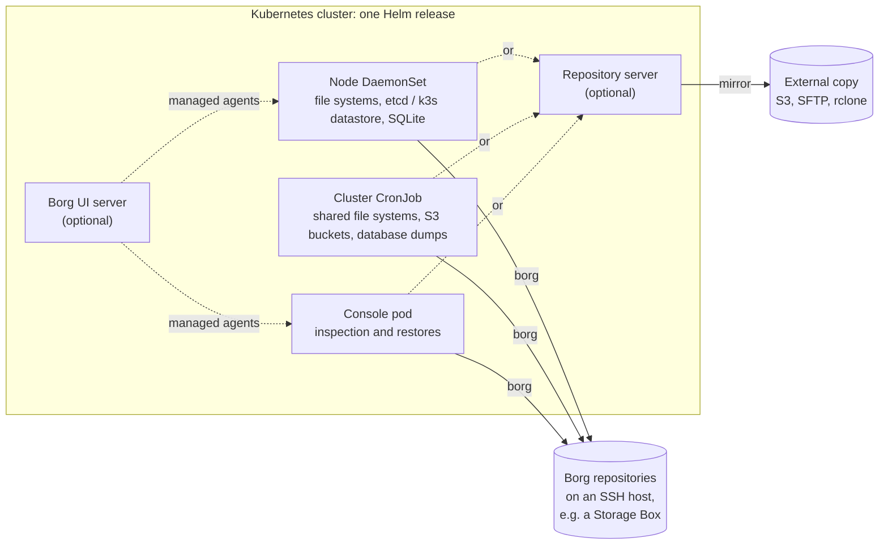

# k8s-borg

**[Documentation](https://k8s-borg.ioanalytica.com)** ·
[Install](https://k8s-borg.ioanalytica.com/guide/install) ·
[Restore](https://k8s-borg.ioanalytica.com/operations/restore) ·
[Releases](https://github.com/ioanalytica/k8s-borg/releases) ·
[Discussions](https://github.com/ioanalytica/k8s-borg/discussions)

[](https://github.com/ioanalytica/k8s-borg/actions/workflows/lint-test.yml)
[](https://github.com/ioanalytica/k8s-borg/actions/workflows/cve-scan.yml)
[](https://github.com/ioanalytica/k8s-borg/releases/latest)
[](https://artifacthub.io/packages/helm/k8s-borg/k8s-borg)
[](LICENSE)

<!-- #region intro -->
Backup for Kubernetes clusters with [BorgBackup](https://www.borgbackup.org/),
packaged as one container image and one Helm chart. k8s-borg runs in production
on Borg 1.

It backs up the nodes, the cluster's shared data, S3 buckets and databases, each
into its own Borg repository. A repository server for Borg 1 and Borg 2 can run
in the same release and keep an external copy of its repositories. Optionally,
the chart deploys a [Borg UI](https://github.com/karanhudia/borg-ui) server and
runs the backups as its managed agents.
<!-- #endregion intro -->

## Quick start

<!-- #region quick-start -->
To see it work first, on a laptop and without a host of your own,
[Try it locally](https://k8s-borg.ioanalytica.com/guide/try-locally) runs the
whole chart in a throwaway k3d cluster, with Borg UI and managed agents, up to
a first backup and restore.

The chart is published as an OCI artifact; the images live on GitHub Container
Registry. A first install needs an SSH host with Borg and a directory there for
the repositories (`mycluster` below, which Borg 1 does not create), a
passphrase, an SSH key the host accepts and the host's `known_hosts` line. The
chart names no paths to back up by default: give them as `R` roots, here each
node's `/etc`. Without `--version`, Helm installs the latest release:

```sh
helm install my-borg oci://ghcr.io/ioanalytica/charts/k8s-borg \
  -n k8s-borg --create-namespace \
  --set borg.repoBase.value="ssh://user@borg.example.com:22/./mycluster" \
  --set borg.passphrase.value="…" \
  --set-file ssh.privateKey=./id_ed25519 \
  --set-file ssh.knownHosts=./known_hosts \
  --set 'node.include={P fm,R /node/etc}'
```

```
ghcr.io/ioanalytica/k8s-borg:<tag>       # backup / agent / repository server image
ghcr.io/ioanalytica/k8s-borg-ui:<tag>    # Borg UI server image, built from the pinned borg-ui
```

For anything beyond a smoke test, keep the sensitive values in a pre-created
Secret (`existingSecret`). The modes, the repository server, Borg 1 vs 2, the
Borg UI options and every parameter are documented on the
[documentation site](https://k8s-borg.ioanalytica.com). A Flux `HelmRelease`
with the Secrets it references is in [`examples/`](examples).
<!-- #endregion quick-start -->

## Why k8s-borg

<!-- #region why -->
- **One release backs up the whole cluster**: the nodes' file systems, the
  cluster datastore (etcd or k3s), dumps of MariaDB, MySQL, PostgreSQL, MongoDB,
  Redis and Valkey, S3 buckets and shared file systems.
- **Borg, in Kubernetes**: deduplication across runs (database dumps stay
  uncompressed so that it works), encryption on the client, and repositories on
  any SSH host with Borg, a Hetzner Storage Box included.
- **A repository server in the same release**, optional: `borg serve` over SSH,
  unprivileged, every client key bound to its own directory with permissions
  the server enforces, and a copy of all repositories on S3 or SFTP for when its
  storage fails. The chart's own backup pods need full access, since they prune
  and compact, and the copy is a mirror, so it protects against lost storage,
  not against deletions; see
  [External copy](https://k8s-borg.ioanalytica.com/features/external-copy).
- **Optional Borg UI integration**: the chart deploys the Borg UI server and
  enrolls the backup pods as its managed agents, with their repositories, check
  schedules and backup plans; the UI itself is
  [Borg UI](https://github.com/karanhudia/borg-ui).
- **Restores that are tested**: every database engine's dump and restore runs
  against real servers in CI, on every push.
<!-- #endregion why -->

<!-- #region architecture -->

<!-- #endregion architecture -->

## Features

<!-- #region features -->
- **Node backups**: a DaemonSet backs up every node's local file systems, one
  repository per node, staying on the node's own file systems: mounts below a
  root (kubelet and CSI volumes, NFS, other partitions) are skipped and named
  in the pod's log. Before the file backup, optionally:
  - a snapshot of the cluster datastore on control-plane nodes — the etcd of
    k3s or kubeadm, or k3s's SQLite — with the k3s server token or kubeadm's
    PKI, held in memory only and removed after the run;
  - consistent copies of SQLite databases on application volumes, made with
    SQLite's online backup while the application keeps writing.
- **Cluster data backups**: a CronJob (or a Borg UI backup plan) backs up shared
  file systems and user homes, S3 buckets, and dumps of databases.
  - S3 buckets are mounted fresh before each run, and their content is checked
    against the bucket listing. A bucket whose mount misses objects is mounted
    again; if objects are still missing, a CronJob run fails (the rest is
    archived anyway), and a Borg UI backup plan ends with a warning.
  - Database dumps of MariaDB, MySQL and Percona Server 8.4, PostgreSQL (the
    whole instance, roles included), MongoDB, and Redis and Valkey (RDB
    snapshots, standalone and cluster). Credentials come from a static
    config, an existing Secret, or the Secret a database operator created in
    the database's namespace. The dumps are not compressed, so Borg
    deduplicates them. `restore-*` scripts restore a whole instance or a
    single database; Redis and Valkey have a documented restore procedure.
- **Console pod**: a StatefulSet with the Borg tools, the database dumps and the
  backup sources at hand, for inspection and restores with `kubectl exec`.
- **Repository server for Borg 1 and Borg 2** (Borg 2 for testing only):
  `sshd` and `borg serve` from the
  same image, unprivileged, with no capabilities and a read-only root file
  system.
  - Every client key is confined to its own directory.
  - Permissions per client, enforced by the server: `all`, `no-delete`,
    `write-only` or `read-only` (Borg 1: `all` or append-only).
  - Adding a client is adding a line to `authorized_keys`.
  - An external copy of the repositories, for the case that the server's
    storage fails: a CronJob mirrors them to S3, an SFTP target such as a
    Hetzner Storage Box, or any other rclone remote — read-only, without a
    lock and without a passphrase.
- **Both Borg majors in one image**: `borg` (1.x) for production, and `borg2`
  (2.x beta, with `borgstore`) for testing only (see below), chosen per
  repository. Borg 2 also reaches plain SFTP targets with no Borg on the server.
- **Borg UI integration (optional)**: the chart deploys the Borg UI server and
  reconciles its configuration:
  - SQLite or an external PostgreSQL, and Redis (in-cluster or external);
  - OIDC login;
  - notification channels;
  - the license key or an offline entitlement;
  - remote machines.

  Node and cluster pods enroll as managed agents and register their
  repositories, check schedules and backup plans. Pre/post-backup scripts are
  published to each agent as an allow-list, so the server can only pick a
  script by name.
- **Tested**: shellcheck, bats unit tests for the wrappers and the chart, and
  end-to-end suites against the real thing:
  - the whole repository lifecycle, the repository server and its external
    copy (to S3 and SFTP), with Borg 1 and Borg 2;
  - every database dump and restore against real servers: PostgreSQL 13–18,
    MariaDB 10.11/11.4/11.8, MySQL and Percona Server 8.4, MongoDB 7.0/8.2,
    Redis 7/8 and Valkey 8/9, and SQLite under write load.

  All of it runs in CI on every push and pull request.
<!-- #endregion features -->

<!-- #region borg2-warning -->
> ⚠️ **Do not use Borg 2 for real backups.** Borg 2 is a beta, and its
> repository format has changed more than once without a conversion path: a
> Borg 2 upgrade can leave a repository that the new Borg cannot open. k8s-borg
> ships Borg 2 so it can be tested; production backups run on Borg 1.
>
> All components (the image, the repository server, and the Borg UI server and
> agents) follow Borg 2 development as closely as possible, so that Borg 2 can
> be used in full as soon as a production-ready release is out.
<!-- #endregion borg2-warning -->

## How it compares

<!-- #region compare -->
k8s-borg backs up data (files, databases, the cluster datastore) into Borg
repositories. It complements the tools that capture the Kubernetes objects
themselves rather than replacing them, and can run next to them:

| Tool | Engine | What it is for |
| --- | --- | --- |
| [Velero](https://velero.io/) | volume snapshots, Kopia | Kubernetes objects and persistent volumes, restored into a cluster by namespace |
| [K8up](https://k8up.io/) | restic | Persistent volume claims, and application data through pre-backup commands |
| [VolSync](https://volsync.readthedocs.io/) | rsync, rclone, restic | Asynchronous replication of persistent volumes, between clusters or to object storage |
| **k8s-borg** | BorgBackup | Node file systems, the cluster datastore, database dumps, S3 buckets and shared file systems, each in its own Borg repository; optionally a repository server and Borg UI |
<!-- #endregion compare -->

## Documentation

The [documentation site](https://k8s-borg.ioanalytica.com) covers the
[configuration](https://k8s-borg.ioanalytica.com/guide/configuration), each feature on a
page of its own, [restore](https://k8s-borg.ioanalytica.com/operations/restore) and
[disaster recovery](https://k8s-borg.ioanalytica.com/operations/disaster-recovery), the
[parameters](https://k8s-borg.ioanalytica.com/reference/parameters) and
[environment variables](https://k8s-borg.ioanalytica.com/reference/environment), and
[development](https://k8s-borg.ioanalytica.com/reference/development): layout, build, tests
and the `borg-ui` submodule.

## What it talks to

<!-- #region talks-to -->
k8s-borg's own scripts connect only to what you configure: the Borg
repositories, the backup sources and databases, the Kubernetes API and, in
agent mode, the Borg UI server. They send no telemetry.

The Borg UI server, when the chart deploys it, contacts Borg UI's own services
by default:

- `https://license.borgui.com` on startup and every 24 hours, for its license
  plan. Air-gapped installs turn this off with `borgUI.licensing.startupSync:
  false` and `borgUI.licensing.activationServiceUrl: ""`.
- `https://t.borgui.com/e` with the server's error reports (Borg UI 2.4.1 and
  later). `borgUI.errorReporting.enabled: false` turns them off.

Analytics and error reports in the browser are a per-user setting in Borg UI.
See [Licensing](https://k8s-borg.ioanalytica.com/features/borg-ui-server#licensing)
and [Error reports](https://k8s-borg.ioanalytica.com/features/borg-ui-server#error-reports)
of the Borg UI server.
<!-- #endregion talks-to -->

## Cost

<!-- #region cost -->
k8s-borg has no paid edition and no features held back. Borg UI, which the
chart can deploy, has a free community plan and paid plans of its own, and
some of its features need a paid plan; see
[Borg UI](https://github.com/karanhudia/borg-ui). The chart applies a Borg UI
license key or offline entitlement if you have one (`borgUI.licensing`).
Standalone backups need no Borg UI at all.
<!-- #endregion cost -->

## Verify the images

<!-- #region verify -->
Releases after 1.2.3 sign their images and their chart with
[Sigstore](https://www.sigstore.dev/) cosign, keyless: the certificate is issued
to this repository's `build.yml` running for the release tag, and each signature
is recorded in the public Rekor log. Every platform of an image also carries an
SPDX SBOM and SLSA provenance. Both are attestation manifests listed in the
image index, so the index's signature covers them.

Resolve the tag once and use the digest from then on, so that what you read
afterwards belongs to what you verified. With
[cosign](https://docs.sigstore.dev/cosign/system_config/installation/) 3:

```sh
# Signed: ghcr.io/ioanalytica/k8s-borg, ghcr.io/ioanalytica/k8s-borg-ui,
# ghcr.io/ioanalytica/k8s-borg-ui-runtime-base and ghcr.io/ioanalytica/charts/k8s-borg
repo=ghcr.io/ioanalytica/k8s-borg
digest=$(docker buildx imagetools inspect "$repo:<tag>" --format '{{json .Manifest}}' | jq -r .digest)
cosign verify "$repo@$digest" \
  --certificate-oidc-issuer https://token.actions.githubusercontent.com \
  --certificate-identity-regexp '^https://github\.com/ioanalytica/k8s-borg/\.github/workflows/build\.yml@refs/tags/'
```

The SBOM and the provenance of an image, per platform:

```sh
docker buildx imagetools inspect "$repo@$digest" --format '{{json .SBOM}}'
docker buildx imagetools inspect "$repo@$digest" --format '{{json .Provenance}}'
```
<!-- #endregion verify -->

## Contributing

Issues, questions in [Discussions](https://github.com/ioanalytica/k8s-borg/discussions)
and pull requests are welcome; see [CONTRIBUTING.md](CONTRIBUTING.md). Report
security issues privately, as [SECURITY.md](SECURITY.md) describes.

## License

<!-- #region license -->
k8s-borg is licensed under the [GNU Affero General Public License v3.0](LICENSE)
(`AGPL-3.0-only`).

Installing and running k8s-borg for your own backups asks nothing of you. If you
distribute k8s-borg, or offer a modified version to others over a network, the
AGPL requires that you offer them the source of your version under the same
license.

The images also contain third-party software under its own license, among
others:

| Component | License |
| --- | --- |
| [Borg UI](https://github.com/karanhudia/borg-ui) (server and agent) | AGPL-3.0 |
| [BorgBackup](https://github.com/borgbackup/borg) and [borgstore](https://github.com/borgbackup/borgstore) | BSD-3-Clause |
| [s3fs-fuse](https://github.com/s3fs-fuse/s3fs-fuse) | GPL-2.0 |
| [rclone](https://rclone.org/) | MIT |
| [etcd](https://github.com/etcd-io/etcd) (`etcdctl`, `etcdutl`) | Apache-2.0 |
| [MongoDB Database Tools](https://github.com/mongodb/mongo-tools) (`mongodump`, `mongorestore`) | Apache-2.0 |
| [Valkey](https://github.com/valkey-io/valkey) (`valkey-cli`) | BSD-3-Clause |
| [MariaDB Connector/C](https://github.com/mariadb-corporation/mariadb-connector-c) (the MariaDB client's authentication plugins) | LGPL-2.1+ |
| [MySQL](https://www.mysql.com/) client 8.4 (`mysql`, `mysqldump`; Oracle's build, in `/opt/mysql`) | GPL-2.0 with Oracle's Universal FOSS Exception |
| GNU C Library, OpenSSL, libstdc++, ncurses and zlib, as the MySQL client's runtime in `/opt/mysql` | LGPL-2.1+, Apache-2.0, GPL-3.0+ with the GCC Runtime Library Exception, MIT, Zlib |
<!-- #endregion license -->
